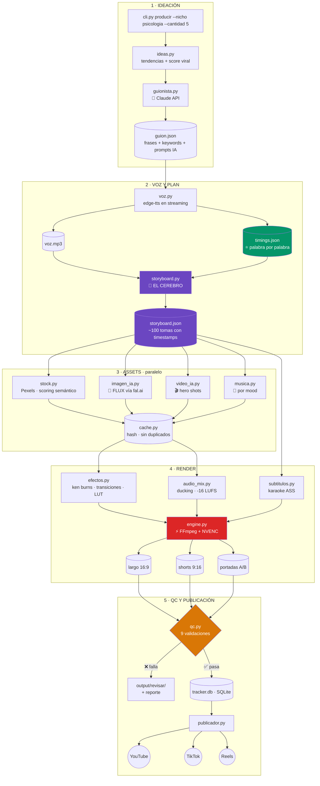

# Arquitectura v2 — "Studio": de fábrica casera a estudio escalable

> Documento de diseño. Sucede a `arquitectura.md` (v1).
> Objetivo: pasar de videos que **se ven automatizados** a videos que **se ven producidos**, y de un script que corre en tu portátil a un sistema que produce 10–20 videos/día sin que tú mires.

---

## Parte 0 — Diagnóstico honesto de la v1

Tu v1 funciona y eso ya es mucho. Pero hay razones técnicas específicas por las que el resultado se ve amateur. No es "falta de pulido": son 6 decisiones concretas de código.

| # | Qué pasa hoy | Por qué se ve mal | Dónde |
|---|---|---|---|
| 1 | **Un solo fondo por sección.** Una sección de 40s = 40s del mismo clip de Pexels en loop | El ojo se aburre a los ~4s. YouTube mide retención y te castiga | `ensamblador.py:203` |
| 2 | **Subtítulo estático de bloque.** Todo el párrafo en pantalla, quieto, toda la sección | Nadie lee un párrafo. Lo pro es karaoke palabra por palabra | `ensamblador.py:220` |
| 3 | **Cero transiciones reales.** El docstring dice "transiciones suaves" pero `concatenate_videoclips(method="compose")` hace un corte seco | Los saltos se sienten bruscos y baratos | `ensamblador.py:284` |
| 4 | **`preset="ultrafast"`** en el export | Es el preset de *peor* calidad de x264. Bloques en zonas oscuras — letal para el nicho de psicología, que es todo oscuro | `ensamblador.py:303` |
| 5 | **Sin música, sin SFX, sin normalización** | El silencio entre frases suena a "grabado en un cuarto". El volumen varía entre videos | (no existe) |
| 6 | **Cámara muerta.** El fondo no se mueve, no hay zoom, no hay grade de color | Un plano fijo + texto = plantilla. El movimiento lento es lo que lee el cerebro como "producido" | (no existe) |

**Y un bug de coherencia que probablemente ya notaste:** `select_fondo()` prioriza *cualquier* fondo local sin usar **antes** de mirar las keywords (`fondos.py:154` de la v1). O sea: tu video de gatitos puede salir con un fondo de "dark city night rain" solo porque estaba descargado. Las keywords solo se usan cuando la caché local se agota.

```python
# fondos.py:150-159 — el problema
unused_fondos = [f for f in local_fondos if f not in used_list]
if unused_fondos:
    selected_file = unused_fondos[0]   # ← ignora 'keywords' por completo
```

**Bug que rompe:** `ensamblador.py:387` → `f"short_{guion_id}.mp4"`, pero la variable se llama `guion["id"]`. `NameError` garantizado.

---

## Parte 1 — La idea central de la v2: el **Storyboard** como artefacto

Esta es *la* diferencia arquitectónica. Todo lo demás se desprende de aquí.

En la v1, guion → video es un solo paso monolítico. Si algo sale mal, re-renderizas todo. Y no puedes revisar nada antes de gastar 20 minutos de CPU.

En la v2 metemos **un archivo JSON intermedio entre el guion y el render**: el `storyboard.json`. Es el plan de rodaje: cada toma, con su timestamp exacto, su visual, su transición y su efecto.

```
guion.json  →  voz.mp3 + timings.json  →  storyboard.json  →  video.mp4
                (edge-tts te da los                ↑
                 tiempos GRATIS)          aquí puedes mirar,
                                          corregir, y re-renderizar
                                          sin re-generar la voz
```

**Por qué esto lo cambia todo:**

- **Reanudable.** Cada etapa cachea en disco. Si el render falla en el minuto 7, no re-generas la voz ni re-descargas los assets.
- **Inspeccionable.** Abres el JSON y ves exactamente qué va a pasar en el segundo 34. Puedes corregir una toma sin tocar código.
- **Barato de iterar.** ¿No te gustó el estilo de subtítulo? Re-renderizas desde el storyboard. La voz y los assets ya están.
- **Paralelizable.** Los assets de las 40 tomas se descargan/generan en paralelo mientras tú no haces nada.
- **Testeable.** Puedes validar el storyboard (¿alguna toma dura más de 6s? ¿alguna keyword quedó vacía?) *antes* de renderizar.

### Ejemplo de `storyboard.json`

```json
{
  "video_id": "psi_042",
  "nicho": "psicologia",
  "formato": { "w": 1080, "h": 1920, "fps": 30 },
  "duracion_total": 58.4,
  "audio": {
    "voz": "voz.mp3",
    "musica": "assets/music/dark_tension_01.mp3",
    "musica_db": -22,
    "ducking": true
  },
  "tomas": [
    {
      "id": 0,
      "t_in": 0.0, "t_out": 3.8,
      "tipo": "hook",
      "visual": {
        "fuente": "ai_image",
        "prompt": "close-up of a human eye reflecting city lights at night, cinematic, moody, dark teal and orange, 35mm",
        "archivo": "assets/psi_042/img_000.png"
      },
      "camara": { "efecto": "ken_burns", "zoom": [1.00, 1.12], "pan": "center" },
      "transicion_salida": { "tipo": "flash", "dur": 0.2 },
      "grade": "dark_teal_orange",
      "subtitulos": [
        { "palabra": "Si",      "t_in": 0.31, "t_out": 0.48 },
        { "palabra": "alguien", "t_in": 0.48, "t_out": 0.92 },
        { "palabra": "hace",    "t_in": 0.92, "t_out": 1.21 },
        { "palabra": "esto",    "t_in": 1.21, "t_out": 1.58 }
      ]
    },
    {
      "id": 1,
      "t_in": 3.8, "t_out": 7.2,
      "tipo": "broll",
      "visual": {
        "fuente": "pexels",
        "query": "person walking alone dark street rain",
        "archivo": "assets/psi_042/pexels_a3f9.mp4",
        "trim": [2.1, 5.5]
      },
      "camara": { "efecto": "slow_push", "zoom": [1.05, 1.00] },
      "transicion_salida": { "tipo": "crossfade", "dur": 0.35 },
      "grade": "dark_teal_orange",
      "subtitulos": [ "..." ]
    }
  ]
}
```

Fíjate en `subtitulos`: **timings a nivel de palabra**. Y no cuestan nada extra — `edge-tts` ya los emite y la v1 los está tirando a la basura. Ver Parte 3.

---

## Parte 2 — Estructura de módulos v2

```
video-studio/
├── studio/
│   ├── config.py          # Pydantic: config tipada y validada, secretos desde .env
│   ├── niche.py           # Reemplaza context.py — objeto Nicho, no estado global
│   │
│   ├── ideas.py           # 💡 NUEVO — genera temas y los puntúa por potencial viral
│   ├── guionista.py       # ✏️  REESCRITO — Claude API escribe el guion, no tú a mano
│   │
│   ├── voz.py             # 🎙️  REESCRITO — TTS + captura de word boundaries
│   ├── storyboard.py      # 🎬 NUEVO — EL CEREBRO: guion+timings → plan de tomas
│   │
│   ├── assets/
│   │   ├── stock.py       # Pexels/Pixabay con scoring semántico real
│   │   ├── imagen_ia.py   # 🎨 NUEVO — Flux/Imagen vía API
│   │   ├── video_ia.py    # 🎨 NUEVO — imagen→video para 1-2 tomas hero
│   │   ├── musica.py      # 🎵 NUEVO — biblioteca de música por nicho y mood
│   │   └── cache.py       # caché con hash — nunca descargas dos veces lo mismo
│   │
│   ├── render/
│   │   ├── engine.py      # FFmpeg filter_complex + NVENC (tu GTX 1650 Ti)
│   │   ├── subtitulos.py  # karaoke ASS/libass — 20x más rápido que PIL
│   │   ├── efectos.py     # ken burns, transiciones, grade, viñeta, grano
│   │   └── audio_mix.py   # ducking sidechain + loudnorm a -14 LUFS
│   │
│   ├── qc.py              # ✅ NUEVO — valida ANTES de subir
│   ├── portadas.py        # miniaturas A/B (2 variantes por video)
│   ├── tracker.py         # SQLite en vez de Excel (Excel se corrompe con concurrencia)
│   └── publicador.py      # YouTube + TikTok + Instagram Reels
│
├── nichos/
│   ├── mascotas/
│   │   ├── nicho.yaml     # voz, paleta, LUT, fuentes, prompts base, tags
│   │   ├── guiones/
│   │   └── output/
│   └── psicologia/
│       └── ...
│
├── assets_globales/
│   ├── musica/            # por mood: tension, wholesome, misterio, energia
│   ├── sfx/               # whoosh, impacto, riser, click
│   ├── overlays/          # grano de film, partículas, fugas de luz
│   ├── luts/              # .cube por nicho
│   └── fonts/             # Montserrat ExtraBold, Anton, Bebas Neue
│
├── .env                   # 🔒 TODAS las claves aquí. NUNCA en config.json
├── .gitignore             # .env, tokens, output/, assets/, *.mp4
└── cli.py                 # reemplaza daniel.py
```

### Cambios de fondo respecto a v1

**`context.py` → `niche.py`.** Hoy `context.ACTIVE_NICHE` es una variable global mutable. Eso te impide renderizar dos nichos en paralelo, y hace que cualquier módulo pueda cambiar el estado de todos los demás. En v2 el nicho es un objeto que se pasa explícito: `Nicho.cargar("psicologia")`.

**Excel → SQLite.** `control.xlsx` es frágil: si dos procesos escriben, se corrompe; si lo tienes abierto en Excel, el script falla. SQLite maneja concurrencia y sigue siendo un archivo. *Puedes seguir exportando a Excel para verlo* — pero la fuente de verdad es la base.

**MoviePy → FFmpeg directo.** MoviePy 1.0.3 decodifica cada frame a un array de numpy en Python. Para un video de 8 min a 30fps son 14.400 frames pasando por Python. FFmpeg hace lo mismo en C con `filter_complex`, y con `h264_nvenc` usa el chip dedicado de tu GTX 1650 Ti. **Esperado: 20 min → 2-3 min por video.**

> ⚠️ Nota: estás en **Python 3.14** con **MoviePy 1.0.3** (release de 2020) y parches manuales de Pillow (`PIL.Image.ANTIALIAS = LANCZOS` en `ensamblador.py:24`). Eso es deuda técnica que va a explotar. Ir a FFmpeg también resuelve esto.

---

## Parte 3 — La receta visual "profesional", desglosada

Aquí está lo que realmente pediste. Cada punto es una técnica concreta, no un adjetivo.

### 3.1 Ritmo de corte — la variable #1 de retención

| Formato | Duración por toma | Tomas totales |
|---|---|---|
| Short (9:16, 45-60s) | **2.0 – 3.5s** | 18–25 |
| Largo (16:9, 8 min) | **4 – 6s** | 80–110 |

Y los cortes van **en los límites de frase**, no cada N segundos fijos. Como ya tienes los timings por palabra, el storyboard corta donde el narrador respira. Eso es lo que se siente "editado por un humano".

> La v1 hace ~6 tomas en 8 minutos. La v2 hace ~100. Ese solo cambio es la mitad del salto de calidad.

### 3.2 Subtítulos karaoke — y son GRATIS

**Este es el hallazgo más importante del análisis.** `edge-tts` emite eventos `WordBoundary` con el offset exacto de cada palabra. Tu v1 los descarta porque llama a edge-tts por `subprocess` (`ensamblador.py:51` de la v1) y solo se queda con el `.mp3`.

Llamando a la librería en Python en vez de por consola, obtienes la sincronización perfecta **sin Whisper, sin GPU, sin costo**:

```python
import edge_tts

async def sintetizar(texto, voz, mp3_path):
    com = edge_tts.Communicate(texto, voz)
    palabras = []
    with open(mp3_path, "wb") as f:
        async for chunk in com.stream():
            if chunk["type"] == "audio":
                f.write(chunk["data"])
            elif chunk["type"] == "WordBoundary":
                palabras.append({
                    "palabra": chunk["text"],
                    "t_in":  chunk["offset"]   / 1e7,          # 100-ns → s
                    "t_out": (chunk["offset"] + chunk["duration"]) / 1e7,
                })
    return palabras   # ← esto alimenta el storyboard
```

Estilo de subtítulo objetivo:
- **2–4 palabras en pantalla**, nunca el párrafo
- Palabra activa en **amarillo `#FFD700`** (psicología) o **naranja `#FF8C42`** (mascotas), el resto en blanco
- **Montserrat ExtraBold**, borde negro 6px + sombra suave
- Pequeño **pop de escala** (1.0 → 1.08 → 1.0 en 120ms) al entrar la palabra
- Posición: 62% de la altura en shorts (arriba de la UI de TikTok/Reels)

Renderizado con **ASS/libass** vía FFmpeg, no con PIL. Tu v1 dibuja el borde con un bucle de 121 llamadas a `draw.text()` por línea (`ensamblador.py:118-121` de la v1) — libass hace lo mismo en C, con antialiasing real.

### 3.3 Movimiento de cámara

Ninguna toma queda quieta. Nunca.

| Efecto | Uso | Parámetro |
|---|---|---|
| **Ken Burns** | imágenes fijas (IA) | zoom 1.00→1.12, 4s, alternando dirección |
| **Slow push** | b-roll de video | zoom 1.05→1.00 |
| **Drift lateral** | tomas de establecimiento | pan 3% horizontal |

Regla: **alterna la dirección entre tomas consecutivas.** Dos zoom-in seguidos se sienten mecánicos.

### 3.4 Transiciones — con criterio, no todas iguales

| Transición | Cuándo | Duración |
|---|---|---|
| **Corte duro** | 70% de los casos, en el beat | 0 |
| **Crossfade** | cambio de sub-tema | 0.3s |
| **Whip pan** + whoosh | cambio de sección mayor | 0.25s |
| **Flash blanco** | después del hook, revelaciones | 0.15s |
| **Glitch RGB** | solo psicología, momentos de tensión | 0.2s |

**El error de novato es poner transición en todo.** El corte duro es la transición por defecto del cine. Las fancy se usan para *marcar estructura*.

### 3.5 Color grade — la firma de cada canal

| | Psicología oscura | Mascotas |
|---|---|---|
| **Look** | teal & orange, contraste alto | cálido, luminoso, saturado |
| **Viñeta** | fuerte (0.4) | sutil (0.15) |
| **Saturación** | 0.85 (desaturado) | 1.20 |
| **Temperatura** | fría en sombras | +200K cálido |
| **Grano** | film grain sutil | ninguno |
| **Negros** | levantados 3% (look cine) | limpios |

Se aplica como LUT `.cube` en FFmpeg: un filtro, costo casi cero. **Y hace que todos tus videos se vean del mismo canal** — eso es branding, y es lo que hace que la gente se suscriba.

### 3.6 Audio — el 50% invisible

Esto es lo que más separa amateur de pro, y es lo que tu v1 no tiene en absoluto.

1. **Voz normalizada a -16 LUFS** (`loudnorm` de FFmpeg) — todos tus videos suenan al mismo volumen
2. **Música de fondo a -22 LUFS** con **ducking sidechain**: la música baja 8dB automáticamente cuando habla el narrador y sube en las pausas
3. **Whoosh** en cada transición fancy, **riser** antes de la revelación del hook
4. **Silencio de 0.4s** antes del punto clave — la pausa dramática es gratis y funciona
5. Compresión suave + de-esser en la voz

```bash
# Ducking real en FFmpeg — la música respira bajo la voz
ffmpeg -i voz.mp3 -i musica.mp3 -filter_complex \
  "[0:a]loudnorm=I=-16:TP=-1.5[voz];
   [1:a]volume=-22dB[mus];
   [mus][voz]sidechaincompress=threshold=0.02:ratio=8:attack=5:release=300[duck];
   [voz][duck]amix=inputs=2:duration=first[out]" \
  -map "[out]" mezcla.mp3
```

### 3.7 Overlays y branding

- **Grano de film** a 8% de opacidad (psicología) — mata el look "digital plano"
- **Fugas de luz** ocasionales en transiciones
- **Intro de 1.2s** con tu logo animado — construye reconocimiento
- **Barra de progreso** sutil abajo en shorts — sube la tasa de completado
- **Marca de agua** discreta esquina superior

---

## Parte 4 — Contenido generado por IA

### 4.1 Imágenes IA — dónde entran

**No reemplazan al stock. Lo complementan.** La regla:

| Situación | Fuente |
|---|---|
| Acción genérica ("perro corriendo", "ciudad de noche") | **Pexels** — es gratis y el video real se ve mejor |
| Concepto abstracto ("la manipulación emocional", "el vacío") | **Imagen IA** — Pexels no tiene esto |
| Hook (primeros 3s) | **Imagen IA** — necesitas una imagen que NADIE haya visto |
| Composición específica que el guion pide | **Imagen IA** |

Mezcla objetivo: **~70% stock / ~30% IA**. Todo IA se ve raro y uniforme; todo stock se ve genérico.

**Tu GTX 1650 Ti tiene 4GB de VRAM.** Es insuficiente para SDXL local con calidad decente, y `torch` ni siquiera tiene ruedas estables para Python 3.14. **Recomendación: API en la nube.**

| Servicio | Modelo | Costo/imagen | Nota |
|---|---|---|---|
| **fal.ai** | FLUX.1 [schnell] | **~$0.003** | ⭐ Mejor relación precio/calidad. 4 pasos, rápido |
| fal.ai | FLUX.1 [dev] | ~$0.025 | Mejor calidad, para portadas |
| Replicate | FLUX schnell | ~$0.003 | Alternativa equivalente |
| Google | Imagen | ~$0.02-0.04 | Excelente en fotorrealismo |

**Costo real por video:** 10 imágenes IA × $0.003 = **$0.03**. A 20 videos/día = **$18/mes**. Nada.

Los prompts se generan desde el guion, con un **prefijo de estilo por nicho** guardado en `nicho.yaml` para que todas las imágenes de un canal se vean hermanas:

```yaml
# nichos/psicologia/nicho.yaml
imagen_ia:
  prefijo: "cinematic still, dark moody lighting, teal and orange grade,
            35mm anamorphic, shallow depth of field, film grain, high contrast"
  negativo: "cartoon, bright, cheerful, text, watermark, deformed hands"
```

### 4.2 Video IA — con moderación

Modelos imagen→video (Kling, Luma, Runway) cuestan **$0.10–0.50 por clip de 5s**. Demasiado para 100 tomas.

**Estrategia:** 1–2 "tomas hero" por video — el hook y el clímax. El resto: Ken Burns sobre imagen IA, que a 4 segundos con zoom lento **se lee casi igual de bien** por una fracción del costo.

**Costo:** ~$0.30/video en tomas hero. Opcional, actívalo por nicho.

### 4.3 Guionista IA — el que te desbloquea la escala

Hoy escribes `guiones.json` a mano. **Ese es tu cuello de botella real.** Con Claude API:

- Genera guion completo con estructura hook/desarrollo/clímax/CTA
- Emite las keywords de b-roll **por frase**, no por sección (10x más granularidad para el storyboard)
- Emite los prompts de imagen IA
- Recibe los hooks ya usados (`get_all_hooks()` de la v1 ya hace esto) para no repetirse
- 3 variantes de título + 2 conceptos de miniatura

**Costo:** ~$0.05-0.15 por guion con Sonnet. A 20/día = **~$60/mes**. Es tu mayor costo variable y el que más valor da.

---

## Parte 5 — Control de calidad automático

Módulo nuevo. **Ningún video se sube sin pasar por aquí.**

```python
CHECKS = [
    ("audio_no_silencioso",   lambda v: v.audio_rms > -40),
    ("loudness_correcto",     lambda v: -17 < v.lufs < -13),
    ("duracion_en_rango",     lambda v: v.spec.min <= v.dur <= v.spec.max),
    ("sin_frames_negros",     lambda v: v.frames_negros_consecutivos < 15),
    ("subtitulos_en_pantalla",lambda v: v.subs_fuera_de_marco == 0),
    ("subtitulos_sincronizados", lambda v: v.deriva_max < 0.25),
    ("resolucion_exacta",     lambda v: v.res == v.spec.res),
    ("sin_tomas_repetidas",   lambda v: v.assets_duplicados == 0),
    ("bitrate_suficiente",    lambda v: v.bitrate > 6_000_000),
]
```

Falla un check → el video va a `output/revisar/` con un reporte, y **no** entra a la cola de subida. Esto es lo que te deja dormir mientras el sistema publica.

---

## Parte 6 — Flujo completo v2



---

## Parte 7 — Rendimiento en tu máquina

**Tu hardware:** i5-10300H (4 núcleos / 8 hilos) · 16GB RAM · GTX 1650 Ti 4GB

| Etapa | v1 (MoviePy, ultrafast) | v2 (FFmpeg + NVENC) |
|---|---|---|
| Voz (8 min de audio) | ~90s | ~60s (streaming) |
| Assets | serial, ~4 min | paralelo, ~90s |
| **Render largo 8 min** | **~20 min** | **~2.5 min** |
| Render short 60s | ~2 min | ~15s |
| **Total por lote (1 largo + 5 shorts)** | **~35 min** | **~6 min** |

Habilitar NVENC:
```bash
ffmpeg -i in.mp4 -c:v h264_nvenc -preset p5 -tune hq -rc vbr -cq 21 -b:v 12M out.mp4
```

> ⚠️ **No tienes FFmpeg instalado** (solo el binario que MoviePy trae empaquetado, que viene sin NVENC). Hay que instalar el build completo:
> ```
> winget install Gyan.FFmpeg
> ```

**Ganancia total: ~6x más rápido y con calidad visiblemente superior**, porque `-cq 21` es muchísimo mejor que `preset=ultrafast`.

---

## Parte 8 — Costos mensuales a escala

Escenario: **2 canales × 1 largo + 5 shorts al día**

| Concepto | Costo/mes |
|---|---|
| Guiones (Claude Sonnet, ~60/mes) | $6 – 12 |
| Imágenes IA (FLUX schnell, ~600/mes) | $2 |
| Video IA hero (opcional, 60 clips) | $18 |
| Pexels / Pixabay | $0 (gratis) |
| edge-tts | $0 (gratis) |
| Música (Pixabay/Uppbeat libres) | $0 |
| Render | $0 (tu portátil) |
| **TOTAL** | **$8 – 32 / mes** |

Si más adelante quieres voz premium: **ElevenLabs $22/mes** (Creator). Vale la pena para psicología oscura, donde la voz *es* el producto. edge-tts es sorprendentemente bueno pero se le nota lo robótico en frases largas.

---

## Parte 9 — Roadmap: en qué orden construir

Ordenado por **impacto visual ÷ esfuerzo**. Cada fase deja el sistema funcionando.

### 🔥 Fase 0 — Salvar el proyecto (1 hora)
1. **Mover** de `.gemini\antigravity\scratch\` a `D:\Proyectos\video-studio\` — esa carpeta scratch es de otra herramienta y se puede borrar sola
2. `git init` + commit inicial
3. **Sacar la API key de Pexels** de los `config.json` → `.env`; `.gitignore` para `.env`, `client_secrets.json`, `youtube_token.json`, `output/`, `*.mp4`
4. Arreglar el `NameError` de `ensamblador.py:387`

### ⭐ Fase 1 — El salto visual (el 80% del resultado)
5. **`voz.py` con word boundaries** — desbloquea todo lo demás
6. **`storyboard.py`** — el cerebro
7. **`subtitulos.py` karaoke ASS**
8. **`engine.py` FFmpeg + NVENC**, ritmo de corte de 2-4s, Ken Burns, crossfades
9. **`audio_mix.py`** — música + ducking + loudnorm

> Al terminar la Fase 1 tus videos ya se ven de otro nivel. Todo lo demás es escala.

### 🎨 Fase 2 — Producción
10. `imagen_ia.py` con FLUX vía fal.ai
11. LUTs y grade por nicho + overlays (grano, viñeta)
12. `stock.py` con scoring semántico real (arregla el bug de coherencia de fondos)
13. Portadas A/B

### 🤖 Fase 3 — Escala
14. `guionista.py` con Claude API — mata tu cuello de botella
15. `ideas.py` con scoring de tendencias
16. `qc.py` — 9 validaciones
17. Excel → SQLite

### 🚀 Fase 4 — Autonomía
18. TikTok + Instagram Reels
19. Programador (cron/Task Scheduler) — producción nocturna
20. Bucle de retroalimentación: lee analytics de YouTube → aprende qué hooks funcionan → alimenta a `ideas.py`

---

## Parte 10 — Decisiones y sus alternativas

| Decisión | Elegido | Alternativa | Por qué |
|---|---|---|---|
| Motor de render | **FFmpeg directo** | MoviePy 2.x | 6-8x más rápido, NVENC, sin deuda de Pillow/py3.14 |
| Subtítulos | **ASS/libass** | PIL frame a frame | Órdenes de magnitud más rápido, mejor antialiasing |
| Sincronía | **edge-tts WordBoundary** | Whisper | Gratis, exacto, sin GPU — Whisper *estima*, esto es la verdad |
| Imágenes IA | **API nube (fal.ai)** | SD local | Tus 4GB de VRAM no alcanzan; $0.003/img no duele |
| Video IA | **Solo hero shots** | Todo con video IA | $0.30/video vs $30/video |
| Base de datos | **SQLite** | Excel | Excel se corrompe con concurrencia y se bloquea si lo abres |
| Config | **YAML + .env** | JSON con secretos | Los secretos nunca en el repo |
| Voz | **edge-tts** (ElevenLabs luego) | ElevenLabs ya | Gratis, decente. Sube cuando el canal monetice |
| Nicho | **objeto explícito** | global mutable | Permite paralelizar por canal |

---

## Resumen de una línea

> **El cambio de fondo no es "agregar transiciones": es meter un `storyboard.json` entre el guion y el render.** Eso convierte una función monolítica de 200 líneas en un pipeline de etapas cacheables, y hace que ritmo de corte, movimiento de cámara, karaoke, grade y assets IA sean *datos configurables* en vez de código nuevo cada vez.
